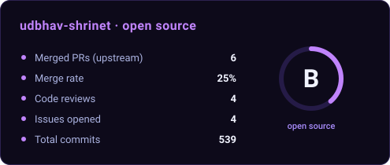

  

  
<i>I turn messy data into systems that run on their own.</i>

  
  
  
  
  

 

<h2 align="center">Hey, I'm Udbhav 👋</h2>

  I'm into <b>data</b>, <b>finance</b> and <b>AI</b> 📊💸🤖 
  Currently learning ML 🧠 
  Feel free to check out my projects and contributions 🚀

  

## Merged pull requests

Merged into projects I don't own. Contributed to: Google Research · Model Context Protocol · Stanford NLP · Hugging Face · DeepEval.

<!-- OSS:START -->
### Merged

| Project | Stars | Pull request | Merged |
|---|---|---|---|
| **[google-research/timesfm](https://github.com/google-research/timesfm)** | 35.1k | [fix(deps): split jax[cuda] into cpu and cuda extras to support CPU-only installs (#443)](https://github.com/google-research/timesfm/pull/539) (#539) | 2026-11-13 |
| [confident-ai/deepeval](https://github.com/confident-ai/deepeval) | 19.5k | [fix(litellm): omit default temperature to prevent failures on reasoning models](https://github.com/confident-ai/deepeval/pull/3431) (#3431) | 2026-11-02 |
| [davidgasquez/awesome-duckdb](https://github.com/davidgasquez/awesome-duckdb) | 2.5k | [Add ds-agent-playbook to Libraries Powered by DuckDB](https://github.com/davidgasquez/awesome-duckdb/pull/372) (#372) | 2026-10-12 |
| [ddotta/awesome-polars](https://github.com/ddotta/awesome-polars) | 1.1k | [Add ds-agent-playbook to Tools Built with Polars](https://github.com/ddotta/awesome-polars/pull/643) (#643) | 2026-10-12 |

### Upstream Architecture & Attributed Solutions

**[Model Context Protocol Servers](https://github.com/modelcontextprotocol/servers)** · 91.6k stars · [Issue #5107](https://github.com/modelcontextprotocol/servers/issues/5107) · [Merged PR #5145](https://github.com/modelcontextprotocol/servers/pull/5145)
> "The fix is the one @udbhav-shrinet proposed on the issue." — Cliff Hall, core maintainer

`git_show` was printing diff headers without the `a/` and `b/` prefixes, so `git apply` didn't work on its output. I found it and proposed the fix, and the maintainers merged it.

**[REA Core](https://github.com/morluto/rea)** · [PR #2787](https://github.com/morluto/rea/pull/2787) · [Merged in `e572c38dc`](https://github.com/morluto/rea/commit/e572c38dcf6ae72176319baef000784ff7d15e2f)
> "Continues #2787, originally contributed by @udbhav-shrinet (Udbhav Shrinet). Original contributor history remains in this branch."

Fixed the guide links across the main docs and the 18 translated builds. A maintainer picked the PR up and merged it with my history kept.

**[Stanford NLP DSPy](https://github.com/stanfordnlp/dspy)** · 22k+ stars · [PR #10606](https://github.com/stanfordnlp/dspy/pull/10606) · fix went in via [Merged PR #10604](https://github.com/stanfordnlp/dspy/pull/10604)

`BootstrapFewShot` treated `metric_threshold=0.0` as if it wasn't set, because 0.0 is falsy in Python. I traced it down and the same fix got merged.

**[Hugging Face Smolagents](https://github.com/huggingface/smolagents)** · 30.1k stars · [Issue #2961](https://github.com/huggingface/smolagents/issues/2961) · [PR #2972](https://github.com/huggingface/smolagents/pull/2972)

The safe serializer was rejecting NumPy scalars and extended-precision values.

### Participated & Mentioned

<b>12 threads</b> · click to expand

 

| Project | Stars | Thread | Activity | Status | Date |
|---|---|---|---|---|---|
| [huggingface/smolagents](https://github.com/huggingface/smolagents) | 30.3k | [BUG: open_deep_research YouTubeConverter silently drops transcripts (get_transcript removed in youtube-transcript-api 1.0)](https://github.com/huggingface/smolagents/issues/3010) (#3010) | Commented | Open | 2026-10-17 |
| [huggingface/smolagents](https://github.com/huggingface/smolagents) | 30.3k | [ENH: Add a first-class NvidiaModel for NVIDIA NIM](https://github.com/huggingface/smolagents/issues/2995) (#2995) | Commented | Open | 2026-10-15 |
| [modelcontextprotocol/servers](https://github.com/modelcontextprotocol/servers) | 92k | [fix(git): prefix git_show diff headers with a/ and b/](https://github.com/modelcontextprotocol/servers/pull/5145) (#5145) | Mentioned | Resolved | 2026-10-13 |
| [BerriAI/litellm](https://github.com/BerriAI/litellm) | 63.2k | [fix(redis): keep the data node host, port and db off Redis Sentinel connections](https://github.com/BerriAI/litellm/pull/46041) (#46041) | Commented | Open | 2026-10-12 |
| [BerriAI/litellm](https://github.com/BerriAI/litellm) | 63.2k | [test(router): stop test_default_model_fallbacks leaking litellm.default_fallbacks](https://github.com/BerriAI/litellm/pull/46014) (#46014) | Commented | Resolved | 2026-10-12 |
| [huggingface/smolagents](https://github.com/huggingface/smolagents) | 30.3k | [BUG: SafeSerializer rejects NumPy string and complex scalar values](https://github.com/huggingface/smolagents/issues/2961) (#2961) | Mentioned & Commented | Resolved | 2026-10-12 |
| [modelcontextprotocol/python-sdk](https://github.com/modelcontextprotocol/python-sdk) | 24.8k | [Add a filesystem backed provider for the Skills extension](https://github.com/modelcontextprotocol/python-sdk/issues/3683) (#3683) | Commented | Open | 2026-10-11 |
| [BerriAI/litellm](https://github.com/BerriAI/litellm) | 63.2k | [fix(databricks): route GPT-5.4+ function-tool calls through the Responses API](https://github.com/BerriAI/litellm/pull/45952) (#45952) | Mentioned & Commented | Open | 2026-10-11 |
| [modelcontextprotocol/python-sdk](https://github.com/modelcontextprotocol/python-sdk) | 24.8k | [[v1.x] Server revalidates every tools/call with one-shot jsonschema.validate(), re-checking the schema each time](https://github.com/modelcontextprotocol/python-sdk/issues/3676) (#3676) | Commented | Open | 2026-10-11 |
| [modelcontextprotocol/servers](https://github.com/modelcontextprotocol/servers) | 92k | [git: git_show diff headers lack git's a/ and b/ path prefixes](https://github.com/modelcontextprotocol/servers/issues/5107) (#5107) | Commented | Resolved | 2026-10-10 |
| [huggingface/smolagents](https://github.com/huggingface/smolagents) | 30.3k | [BUG: Tool.to_dict rejects valid tuple aliases in with statements as undefined names](https://github.com/huggingface/smolagents/issues/2942) (#2942) | Commented | Open | 2026-10-10 |
| [huggingface/smolagents](https://github.com/huggingface/smolagents) | 30.3k | [BUG: LocalPythonExecutor loses print output when print is passed as a callback](https://github.com/huggingface/smolagents/issues/2941) (#2941) | Commented | Open | 2026-10-10 |

Auto-generated from public GitHub activity · updated 2026-11-13 UTC

<!-- OSS:END -->

  

## Stack

  <b>LANGUAGES</b> 
  
  
  
  
  
  

  <b>DATA & ML</b> 
  
  
  
  
  
  
  

  <b>AGENTIC AI</b> 
  
  
  
  

  <b>INFRA & DATABASES</b> 
  
  
  
  
  
  
  

  

  <picture>
    <source media="(prefers-color-scheme: dark)" srcset="https://raw.githubusercontent.com/udbhav-shrinet/udbhav-shrinet/output/github-contribution-grid-snake-dark.svg" />
    
  </picture>

